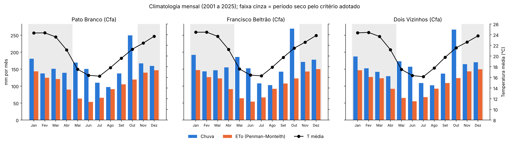
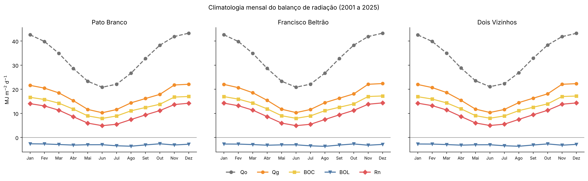
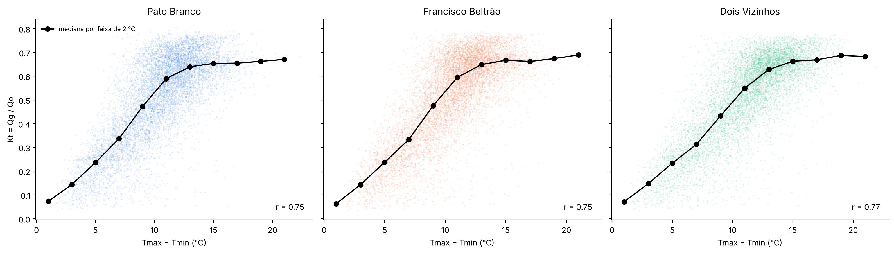
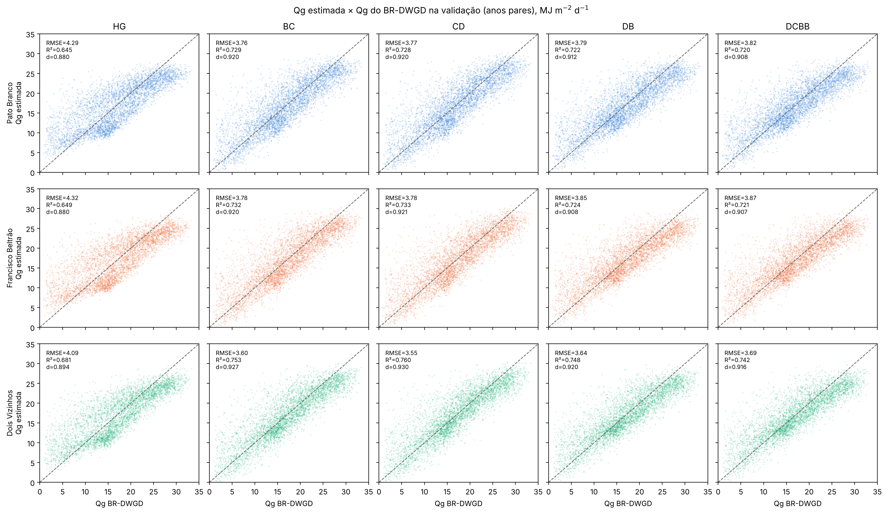
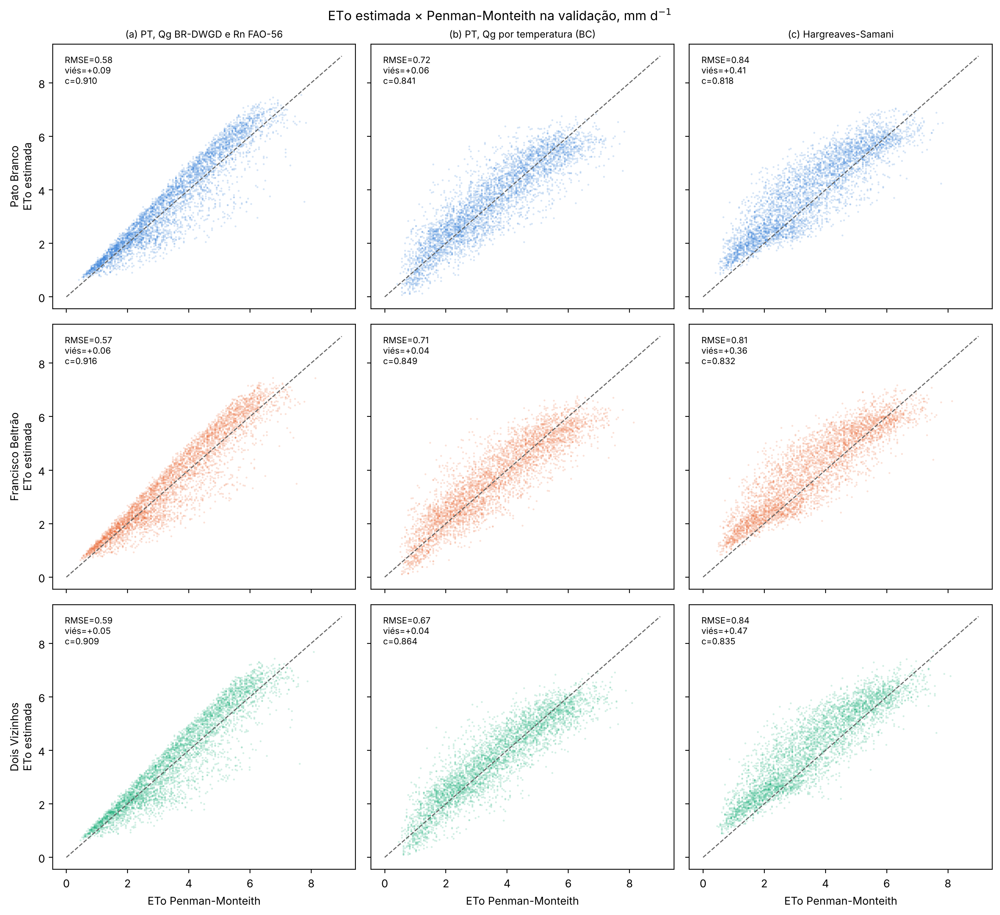
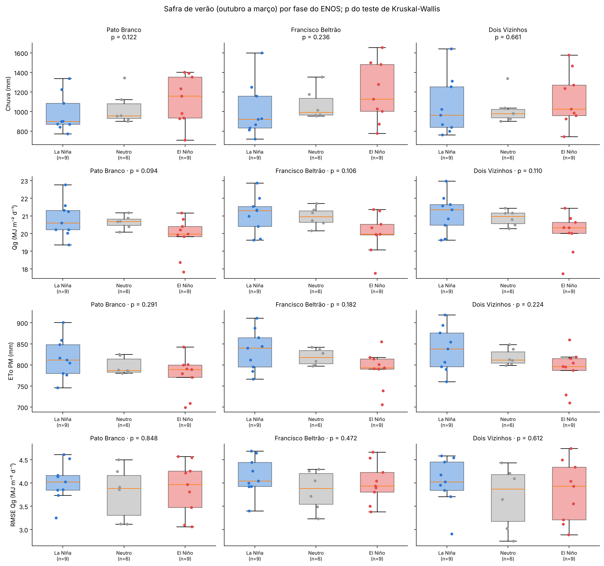

# Estimativa da radiação solar global, do saldo de radiação e da evapotranspiração de referência a partir da temperatura do ar no Sudoeste do Paraná

**Autores:** Tassiane Anzolin; **[nomes dos demais integrantes do grupo]**

Programa de Pós-Graduação em Tecnologias Computacionais para o Agronegócio (PPGTCA), UTFPR, Câmpus Santa Helena
Disciplina: Relações Físicas do Ambiente Agrícola · Projeto 1

---

## Resumo

A radiação solar global (Qg) é a principal entrada de energia nos modelos de evapotranspiração, mas é medida em poucas estações, enquanto a temperatura do ar é medida em quase todas. Este trabalho avaliou, para Pato Branco, Francisco Beltrão e Dois Vizinhos (PR), quanto erro chega à evapotranspiração de referência (ETo) quando ela é estimada apenas com a temperatura, e em que elo da cadeia temperatura → Qg → saldo de radiação (Rn) → ETo esse erro nasce. Com dados diários do BR-DWGD (Xavier et al., 2022) de 2001 a 2025, foram calibrados (anos ímpares) e validados (anos pares) cinco modelos de Qg baseados na amplitude térmica (Fernandes et al., 2018), quatro modelos de Rn e o método de Priestley-Taylor (Fietz & Fisch, 2009). Os modelos exponenciais estimaram Qg com RMSE de 3,55 a 3,78 MJ m⁻² d⁻¹ e desempenho "muito bom" (c de 0,79 a 0,81), e os coeficientes puderam ser trocados entre os três municípios com aumento de no máximo 3,7% no RMSE. A cadeia que usa apenas temperatura estimou a ETo diária com RMSE de 0,67 a 0,72 mm d⁻¹, contra 0,57 a 0,59 mm d⁻¹ com a Qg do BR-DWGD e 0,81 a 0,84 mm d⁻¹ com Hargreaves-Samani, que superestimou a ETo anual em 10% a 13%. A estimativa de Qg respondeu por 43% a 51% do erro quadrático da cadeia; o restante já existe no próprio Priestley-Taylor. Nos totais mensais, o erro da cadeia caiu para 8% a 9%, com viés anual abaixo de 2%. Nas safras de El Niño, Qg e ETo foram menores e o excedente hídrico maior, sem piora dos modelos de Qg.

**Palavras-chave:** amplitude térmica; Priestley-Taylor; saldo de radiação; BR-DWGD; El Niño.

---

## 1. Introdução

A evapotranspiração de referência (ETo) é a base do manejo da irrigação, do balanço hídrico climatológico e dos modelos de produtividade, como o da Zona Agroecológica da FAO. O método padrão, Penman-Monteith FAO-56 (Allen et al., 1998), exige radiação solar, temperatura, umidade relativa e velocidade do vento. A radiação solar global (Qg), porém, é medida em uma rede muito menos densa que a de temperatura, e séries longas de Qg medida são raras.

Uma alternativa é estimar Qg pela **amplitude térmica diária**. Em dias de céu limpo, a superfície recebe muita radiação de onda curta durante o dia, elevando a Tmax, e perde muita radiação de onda longa à noite, derrubando a Tmin. Em dias nublados ocorre o contrário. Assim, ΔT = Tmax − Tmin funciona como um indicador da transmissividade atmosférica. Fernandes et al. (2018) calibraram para Goiás cinco modelos com essa base: Hargreaves (HG), Bristow-Campbell (BC), Donatelli-Campbell (CD), Donatelli-Bellocchi (DB) e a combinação dos dois últimos (DCBB).

Com Qg disponível, o saldo de radiação (Rn) pode ser estimado por relações simples, e a ETo pelo método de Priestley-Taylor (Priestley & Taylor, 1972), que depende essencialmente da energia disponível. Fietz & Fisch (2009) avaliaram essas relações em Dourados (MS). Se Rn for proporcional a Qg, Priestley-Taylor se reduz a ETo = k · W · Qg, equação que só precisa de temperatura (para W) e de Qg.

Este trabalho integra os dois artigos para responder: **se houver apenas termômetro, quanto erro chega à ETo, e em que elo da cadeia temperatura → Qg → Rn → ETo esse erro nasce?** A análise foi feita para três municípios próximos do Sudoeste do Paraná, o que permite avaliar também se os coeficientes calibrados em um local servem para os outros. Como complemento, avaliou-se o efeito do El Niño-Oscilação Sul (ENOS) sobre a radiação, a ETo e o desempenho dos modelos nas safras de verão.

## 2. Material e métodos

### 2.1 Área de estudo

Os locais são Pato Branco, Francisco Beltrão e Dois Vizinhos, no Terceiro Planalto Paranaense, região de solos derivados de basalto, agricultura de grãos feita em grande parte por produtores familiares e importante bacia leiteira. Pela própria série de dados, os três pontos se classificam como Cfa (subtropical úmido com verão quente, sem estação seca definida; Alvares et al., 2013); as partes mais altas de Pato Branco, que chegam a 927 m, ficam na transição para Cfb. Em cada município, o ponto de análise foi a posição da estação meteorológica de referência: as do IDR-Paraná (antigo IAPAR) em Pato Branco e Francisco Beltrão e a estação automática A843 do INMET em Dois Vizinhos (Tabela 1). A altitude usada nos cálculos é a do SRTM (30 m) no próprio ponto.

**Tabela 1.** Locais de estudo. Área, altitude média e chuva referem-se ao município (FAO/GAUL, SRTM e CHIRPS, 2001 a 2025).

| Município | Estação de referência | Latitude (°) | Longitude (°) | Altitude do ponto (m) | Área (km²) | Altitude média (m) | Chuva anual CHIRPS (mm) |
|---|---|---|---|---|---|---|---|
| Pato Branco | IDR-Paraná | −26,12 | −52,68 | 702 | 540,1 | 709 | 1.911 |
| Francisco Beltrão | IDR-Paraná | −26,08 | −53,07 | 584 | 719,0 | 656 | 1.966 |
| Dois Vizinhos | INMET A843 | −25,70 | −53,09 | 545 | 418,9 | 528 | 1.909 |

### 2.2 Dados e controle de qualidade

Foram usados dados diários do BR-DWGD (Xavier et al., 2022), com resolução de 0,1°, de 2001 a 2025 (9.131 dias por local): precipitação, Tmax, Tmin, umidade relativa, vento, Qg e ETo Penman-Monteith. Os dados foram extraídos no Google Earth Engine ano a ano, porque a série completa ultrapassa o limite de uma requisição, e convertidos pelos fatores de escala de cada banda. O controle de qualidade (faixas plausíveis, Tmin > Tmax e Qg > Qo) não descartou nenhum dia.

Como a chuva média supera a ETo em todos os meses, não há meses secos no sentido estrito. Para as comparações por período, adotou-se a janela de seis meses contínuos com menor saldo P − ETo, que resultou em **novembro a abril** nos três locais, contra **maio a outubro**.

### 2.3 Balanço de radiação

Qo foi calculada pela posição astronômica com a biblioteca `agrometeorologiapy`, e o balanço de radiação seguiu a FAO-56 (Allen et al., 1998): BOC = Qg · (1 − r), com albedo r = 0,23 (grama de referência, coerente com a ETo usada na comparação); BOL pela equação de Stefan-Boltzmann corrigida, com ea pela umidade relativa e Qg/Qg,cs limitada a 1, sendo Qg,cs = (0,75 + 2 · 10⁻⁵ · z) · Qo; e Rn = BOC + BOL.

### 2.4 Modelos de Qg a partir da temperatura

Seguindo Fernandes et al. (2018), foram usadas as variáveis ΔTᵢ = Tmaxᵢ − (Tminᵢ + Tminᵢ₊₁)/2 (com a Tmin do dia seguinte), ΔTavg (média móvel centrada de 7 dias de ΔTᵢ) e Tavg = (Tmax + Tmin)/2 (Quadro 1).

**Quadro 1.** Modelos de Qg avaliados.

| Modelo | Equação | Parâmetros |
|---|---|---|
| HG | Qg = b · Qo · √ΔTᵢ + c | b, c |
| BC | Qg = 0,75 · [1 − exp(−b · ΔTᵢᶜ / ΔTavg)] · Qo | b, c |
| CD | Qg = 0,75 · [1 − exp(−b · f(Tavg) · ΔTᵢ² · exp(Tmin/Tnc))] · Qo | b, Tnc |
| DB | Qg = 0,75 · [1 + f(NDA)] · [1 − exp(−b · ΔTᵢ² / ΔTavg)] · Qo | b, C1, C2 |
| DCBB | Qg = 0,75 · [1 + f(NDA)] · [1 − exp(−b · ΔTᵢ² · exp(Tmin/Tnc) / ΔTavg)] · Qo | b, C1, C2, Tnc |

f(Tavg) = 0,017 · exp[exp(−0,053 · Tavg)]; f(NDA) = C1 · [sen(NDA · C2 · π/180) + cos(NDA · f₃ · π/180)], com f₃ = 1 − 1,9 · C3 + 3,83 · C3² e C3 = C2 − int(C2).

Os parâmetros foram ajustados por mínimos quadrados não lineares nos **anos ímpares**, partindo de vários chutes iniciais, e avaliados nos **anos pares**. O melhor modelo de cada local foi o de maior eficiência de Nash-Sutcliffe (EF) na validação. Para avaliar a transferibilidade, os parâmetros de cada local foram aplicados aos outros dois, e foi ajustado também um conjunto **regional** com os três locais juntos.

### 2.5 Saldo de radiação e Priestley-Taylor

Foram calibrados quatro modelos de Rn contra o Rn FAO-56 (Tabela 4). A ETo de Priestley-Taylor foi calculada como ETo = αPT · W · Rn / λ, com αPT = 1,26, λ = 2,45 MJ kg⁻¹ e fluxo de calor no solo nulo na escala diária. O fator W = Δ/(Δ + γ) foi obtido pela aproximação linear usada por Fietz & Fisch (2009) e comparado com o W exato da altitude de cada ponto. Combinando Priestley-Taylor com o modelo (3), Rn = α₃ · Qg, obteve-se a equação local ETo = k · W · Qg, com k = αPT · α₃ / λ. Por fim, αPT foi recalibrado por regressão pela origem da ETo Penman-Monteith contra W · Rn / λ, em cada período.

### 2.6 Integração das duas cadeias

Foram comparadas com a ETo Penman-Monteith do BR-DWGD, nos anos pares, quatro estimativas: (a) Priestley-Taylor com Qg do BR-DWGD e Rn FAO-56; (a2) Priestley-Taylor com Qg do BR-DWGD e Rn = α₃ · Qg, isto é, a equação local; (b) a equação local com Qg estimada pelo melhor modelo de temperatura, ou seja, **apenas temperatura**; (c) Hargreaves-Samani (Hargreaves & Samani, 1985), também apenas com temperatura. O erro quadrático médio (RMSE²) de (b) foi decomposto em três parcelas: a que já existe em (a), a que muda ao trocar o Rn FAO-56 por α₃ · Qg (a2 − a) e a que nasce na estimativa de Qg (b − a2). As estimativas também foram somadas em totais mensais e anuais, escala usada no balanço hídrico.

### 2.7 ENOS

Cada safra de verão (outubro do ano A a março do ano A+1) foi classificada pelo Índice Oceânico Niño (ONI, NOAA/CPC) do trimestre novembro-dezembro-janeiro: El Niño se ONI ≥ +0,5, La Niña se ONI ≤ −0,5 e neutra nos demais casos, simplificação do critério oficial suficiente para separar as safras por fase. Das 24 safras, 9 foram de El Niño, 9 de La Niña e 6 neutras. As fases foram comparadas pelo teste de Kruskal-Wallis, e a relação com o ONI, pela correlação de Spearman.

### 2.8 Métricas de desempenho

As métricas foram implementadas como funções próprias: RMSE, RMSE relativo (RRMSE), viés médio, EF (Nash & Sutcliffe, 1970), R², índice de concordância d (Willmott, 1981) e índice de desempenho c = r · d, classificado segundo Camargo & Sentelhas (1997), de "péssimo" (≤ 0,40) a "ótimo" (> 0,85).

## 3. Resultados e discussão

### 3.1 Clima e balanço de radiação

A chuva média anual do BR-DWGD foi de 1.848 mm em Pato Branco, 1.947 mm em Francisco Beltrão e 1.890 mm em Dois Vizinhos, bem distribuída ao longo do ano, com máximo em outubro (249 a 269 mm) e mínimo em agosto (97 a 103 mm) (Figura 1). A ETo Penman-Monteith somou 1.262 a 1.293 mm por ano, com máximo em dezembro e janeiro (cerca de 145 a 150 mm) e mínimo em junho (53 a 55 mm). A temperatura média anual foi de 20,7 a 20,8 °C. A chuva supera a ETo em todos os meses; agosto é o mês com menor folga.

*Figura 1. Climatologia mensal de chuva, ETo Penman-Monteith e temperatura média (2001 a 2025). A faixa cinza indica o período de menor excedente hídrico (novembro a abril).*

Qo variou de cerca de 21 MJ m⁻² d⁻¹ em junho a 43 MJ m⁻² d⁻¹ em dezembro (Figura 2), com média anual de 32,9 MJ m⁻² d⁻¹. A Qg média foi de 16,8 a 17,0 MJ m⁻² d⁻¹, e a transmissividade média (Kt = Qg/Qo) foi de 0,51 a 0,52, variando pouco ao longo do ano: o menor valor ocorreu em outubro (0,47), o mês mais chuvoso, e o maior em agosto (0,54), o mais seco. O BOL ficou entre −2,6 e −3,7 MJ m⁻² d⁻¹ em todos os meses, com média de −3,0. Como ele quase não muda, o Rn caiu proporcionalmente mais que Qg no inverno: de 14,3 MJ m⁻² d⁻¹ em dezembro para 4,9 a 5,0 MJ m⁻² d⁻¹ em junho. Os três locais têm balanços praticamente iguais (Rn médio de 9,9 a 10,0 MJ m⁻² d⁻¹), como esperado pela proximidade.

*Figura 2. Climatologia mensal de Qo, Qg, BOC, BOL e Rn (2001 a 2025).*

A base física dos modelos de Fernandes et al. (2018) aparece na Figura 3: a transmissividade cresce com a amplitude térmica até cerca de 13 °C e depois se estabiliza entre 0,65 e 0,69, o patamar de céu limpo. A correlação entre ΔT e Kt foi de 0,75 em Pato Branco e Francisco Beltrão e de 0,77 em Dois Vizinhos. A dispersão em torno da curva, grande para amplitudes de 5 a 12 °C, é o erro que nenhum modelo baseado apenas em temperatura consegue remover.

*Figura 3. Transmissividade atmosférica (Kt = Qg/Qo) em função da amplitude térmica diária. Pontos pretos: mediana por faixa de 2 °C.*

### 3.2 Qg a partir da temperatura

Na validação, os quatro modelos exponenciais tiveram desempenho "muito bom" nos três locais, com RMSE de 3,55 a 3,87 MJ m⁻² d⁻¹ (RRMSE de 21% a 23%) e viés inferior a 0,2 MJ m⁻² d⁻¹ em valor absoluto (Tabela 2, Figura 4). O melhor modelo foi o BC em Pato Branco e o CD em Francisco Beltrão e em Dois Vizinhos, mas a diferença entre eles foi pequena: pela EF média dos três locais, a ordem foi CD (0,739), BC (0,736), DB (0,729), DCBB (0,725) e HG (0,657). As métricas de calibração e validação foram muito próximas, o que indica que não houve sobreajuste. O HG, que relaciona Qg linearmente a √ΔT, teve o pior desempenho ("bom") e a maior dispersão: sem um limite superior, ele não representa a saturação de Qg em dias de céu limpo, visível na Figura 3.

**Tabela 2.** Desempenho dos modelos de Qg na validação (anos pares). RMSE em MJ m⁻² d⁻¹. PB: Pato Branco; FB: Francisco Beltrão; DV: Dois Vizinhos. Em negrito, o melhor modelo de cada local.

| Modelo | RMSE PB | EF PB | c PB | RMSE FB | EF FB | c FB | RMSE DV | EF DV | c DV |
|---|---|---|---|---|---|---|---|---|---|
| HG | 4,29 | 0,644 | 0,706 | 4,32 | 0,648 | 0,709 | 4,09 | 0,679 | 0,737 |
| BC | **3,76** | **0,727** | **0,786** | 3,78 | 0,730 | 0,788 | 3,60 | 0,752 | 0,804 |
| CD | 3,77 | 0,725 | 0,785 | **3,78** | **0,731** | **0,789** | **3,55** | **0,759** | **0,810** |
| DB | 3,80 | 0,722 | 0,775 | 3,85 | 0,720 | 0,773 | 3,64 | 0,746 | 0,796 |
| DCBB | 3,82 | 0,718 | 0,771 | 3,87 | 0,718 | 0,771 | 3,69 | 0,739 | 0,789 |

*Figura 4. Qg estimada × Qg do BR-DWGD na validação, por modelo e local.*

Os modelos com mais parâmetros não trouxeram ganho. No CD e no DCBB, o parâmetro Tnc ficou no limite superior do ajuste (300 °C) nos três locais, o que torna o termo exp(Tmin/Tnc) praticamente constante: a Tmin não acrescentou informação além da amplitude térmica. O termo sazonal f(NDA) do DB e do DCBB também pouco acrescentou, porque a sazonalidade já está em Qo e em ΔTavg. Todos os modelos subestimam os dias de Qg acima de cerca de 27 MJ m⁻² d⁻¹, porque o fator 0,75 · Qo limita a estimativa abaixo dos maiores valores de transmissividade.

Na escala diária, o índice c do melhor modelo foi maior de novembro a abril (0,75 a 0,77) que de maio a outubro (0,69 a 0,74): no outono e no inverno, a passagem de frentes frias altera a temperatura por advecção, independentemente da nebulosidade local. Na escala mensal, os erros diários se compensam e o c sobe para 0,92 a 0,93, o que torna a estimativa por temperatura bem mais confiável para o balanço hídrico climatológico que para o manejo diário.

Os coeficientes são transferíveis: aplicar a um local os coeficientes de outro aumentou o RMSE em média 0,9% e no máximo 3,7%, e o conjunto regional único (Tabela 3) aumentou o RMSE em no máximo 1,6%. Para o Sudoeste do Paraná, um único conjunto de coeficientes basta.

**Tabela 3.** Parâmetros regionais dos modelos de Qg, calibrados com os anos ímpares dos três locais juntos.

| Modelo | b | c | Tnc | C1 | C2 |
|---|---|---|---|---|---|
| HG | 0,1759 | −2,0116 | | | |
| BC | 0,0622 | 2,2516 | | | |
| CD | 0,4307 | | 300 | | |
| DB | 0,1166 | | | −0,0273 | 1,6116 |
| DCBB | 0,1108 | | 300 | −0,0289 | 1,6056 |

### 3.3 Saldo de radiação e Priestley-Taylor

O modelo (4), que combina Qg e Qo, foi o mais exato (c = 0,96, RMSE de 1,08 a 1,09 MJ m⁻² d⁻¹), seguido do (3) (c = 0,93, RMSE de 1,30 a 1,32 MJ m⁻² d⁻¹) e do (2) (c = 0,85) (Tabela 4). O modelo (1), que usa apenas Tmax e Tmin sem nenhuma informação de radiação, foi "sofrível" (c de 0,52 a 0,54): sem Qo, ele não distingue a época do ano nem dias claros de nublados. O coeficiente α do modelo (3) foi de 0,59 nos três locais, isto é, 59% de Qg se converte em Rn na média do ano. O valor é mais próximo dos 0,57 de Piracicaba (SP) que dos 0,44 de Dourados (MS), ambos citados por Fietz & Fisch (2009). Parte da diferença em relação a Dourados vem do método: lá o Rn foi medido por saldo-radiômetro, aqui foi calculado pela FAO-56 com albedo de 0,23. Como o próprio Rn de referência foi calculado a partir de Qg, os modelos (3) e (4) partem com vantagem, e o desempenho deles é um limite superior do que se obteria contra Rn medido.

**Tabela 4.** Modelos de Rn: parâmetros e desempenho na validação (valores dos três locais, que diferiram no máximo em 0,02 no índice c).

| Modelo | Equação | α | β | RMSE (MJ m⁻² d⁻¹) | c | Desempenho |
|---|---|---|---|---|---|---|
| (1) | α · Tmax + β · Tmin | 0,49 a 0,54 | −0,25 a −0,19 | 3,22 a 3,28 | 0,52 a 0,54 | Sofrível |
| (2) | α · (Tmax − Tmin)^β · Qo | 0,065 a 0,067 | 0,64 a 0,66 | 1,92 a 1,94 | 0,85 | Ótimo |
| (3) | α · Qg | 0,59 | | 1,30 a 1,32 | 0,93 | Ótimo |
| (4) | α · Qg + β · Qo | 0,47 | 0,07 | 1,08 a 1,09 | 0,96 | Ótimo |

A razão Rn/Qg não é constante: vai de 0,65 em janeiro a 0,47 em julho. Como o BOC é sempre 77% de Qg e o BOL quase não diminui no inverno, a perda de onda longa pesa mais quando Qg é menor. Por isso o modelo (3), com α fixo, superestima o Rn no inverno e o subestima no verão, e o modelo (4), com o termo em Qo, representa melhor essa variação.

O Priestley-Taylor com Rn FAO-56 reproduziu a ETo Penman-Monteith com RMSE de 0,57 a 0,59 mm d⁻¹ e desempenho "ótimo" (c de 0,91 a 0,92). Usar o W exato em vez da aproximação linear **piorou** o resultado (RMSE de 0,60 a 0,62 mm d⁻¹, viés de +0,12 a +0,18 mm d⁻¹): a aproximação linear subestima W e compensa em parte a superestimação causada pelo αPT = 1,26, alto para a região, onde o valor recalibrado no ano todo foi de 1,20 a 1,21. A equação local ETo = k · W · Qg, com k de 0,303 a 0,304, foi a melhor estimativa com Priestley-Taylor (RMSE de 0,50 a 0,51 mm d⁻¹, c de 0,93), porque o α₃ calibrado absorve parte desse viés.

O αPT recalibrado foi de 1,15 a 1,16 de novembro a abril e de 1,33 a 1,36 de maio a outubro. No verão úmido, a ETo é controlada pela energia, e um α abaixo de 1,26 é coerente com ar próximo da saturação. No outono e no inverno, o Rn é pequeno e a entrada de ar mais seco aumenta o termo aerodinâmico em relação à energia disponível, e um αPT fixo subestima a ETo.

### 3.4 Quanto erro chega à ETo usando apenas temperatura

Usando apenas temperatura (cenário b), a ETo diária foi estimada com RMSE de 0,72 mm d⁻¹ em Pato Branco, 0,71 mm d⁻¹ em Francisco Beltrão e 0,67 mm d⁻¹ em Dois Vizinhos, com viés de até 0,06 mm d⁻¹ e desempenho "muito bom" a "ótimo" (c de 0,84 a 0,86) (Tabela 5, Figura 5). O Hargreaves-Samani (cenário c), que também usa apenas temperatura, foi pior (RMSE de 0,81 a 0,84 mm d⁻¹) e superestimou a ETo em 0,36 a 0,47 mm d⁻¹, tendência já conhecida do método em clima úmido, onde a amplitude térmica, sozinha, superestima a demanda atmosférica.

**Tabela 5.** ETo estimada × Penman-Monteith nos anos pares (escala diária). RMSE e viés em mm d⁻¹. PB: Pato Branco; FB: Francisco Beltrão; DV: Dois Vizinhos. Cenários: (a) Qg do BR-DWGD e Rn FAO-56; (a2) Qg do BR-DWGD e Rn = α₃ · Qg; (b) só temperatura; (c) Hargreaves-Samani.

| Cenário | RMSE PB | RMSE FB | RMSE DV | Viés PB | Viés FB | Viés DV | c PB | c FB | c DV |
|---|---|---|---|---|---|---|---|---|---|
| (a) | 0,585 | 0,573 | 0,589 | +0,09 | +0,06 | +0,05 | 0,910 | 0,916 | 0,909 |
| (a2) | 0,508 | 0,499 | 0,506 | +0,08 | +0,05 | +0,04 | 0,927 | 0,931 | 0,928 |
| (b) | 0,720 | 0,711 | 0,669 | +0,06 | +0,04 | +0,04 | 0,841 | 0,849 | 0,864 |
| (c) | 0,838 | 0,807 | 0,841 | +0,41 | +0,36 | +0,47 | 0,818 | 0,832 | 0,835 |

**Tabela 6.** Decomposição do erro quadrático médio da ETo do cenário (b), só temperatura.

| Parcela do erro de (b) | Pato Branco | Francisco Beltrão | Dois Vizinhos |
|---|---|---|---|
| Já existe em (a): Priestley-Taylor, W e Rn FAO-56 | 66% | 65% | 77% |
| Troca do Rn FAO-56 por α₃ · Qg (a2 − a) | −16% | −16% | −20% |
| Estimativa de Qg pela temperatura (b − a2) | 50% | 51% | 43% |

*Figura 5. ETo estimada pelos cenários (a), (b) e (c) × ETo Penman-Monteith nos anos pares.*

A estimativa de Qg pela temperatura respondeu por 43% a 51% do erro quadrático da cadeia (Tabela 6). Uma parcela maior (65% a 77%) já existe no cenário (a), com a Qg de referência, e vem do próprio Priestley-Taylor, que ignora o termo aerodinâmico. A troca do Rn FAO-56 por α₃ · Qg teve parcela negativa (−16% a −20%): ela **reduziu** o erro, porque o α₃ calibrado corrige parte do viés do αPT. A resposta à pergunta central é que os dois elos pesam de forma parecida: melhorar só a Qg reduziria no máximo metade do erro. O cenário (b) também comprime os extremos (Figura 5), superestimando os dias de ETo abaixo de 1,5 mm e subestimando os acima de 6 mm, porque os modelos de Qg subestimam os dias mais claros. Ao longo do ano, o erro de (b) foi maior de agosto a dezembro (cerca de 0,7 a 0,9 mm d⁻¹), quando a ETo cresce e a nebulosidade varia mais, e menor em maio e junho (cerca de 0,5 mm d⁻¹).

Na escala do balanço hídrico, o erro diminui bastante: nos totais mensais, o RMSE do cenário (b) foi de 9,1 a 10,2 mm (RRMSE de 8% a 9%, c de 0,94 a 0,95), e o viés da ETo anual ficou entre +1,1% e +1,6%. O Hargreaves-Samani teve RMSE mensal de 15 a 18 mm e superestimou a ETo anual em 10% a 13%, isto é, 130 a 175 mm a mais por ano.

### 3.5 ENOS

Nas safras de El Niño, a chuva de outubro a março foi em média 143 mm maior em Pato Branco, 182 mm em Francisco Beltrão e 81 mm em Dois Vizinhos do que nas de La Niña; a Qg foi 1,0 a 1,1 MJ m⁻² d⁻¹ menor, e a ETo, 40 a 46 mm menor (Tabela 7, Figura 6). Com só 6 a 9 safras por fase, o teste de Kruskal-Wallis não separou as fases ao nível de 5% (p de 0,09 a 0,66), mas a correlação de Spearman com o ONI, que usa todas as safras, foi significativa para a chuva (ρ de 0,53 a 0,56, p < 0,01) em Pato Branco e Francisco Beltrão, para a Qg nos três locais (ρ de −0,46 a −0,48, p < 0,03) e para o saldo P − ETo nos três locais (ρ de 0,42 a 0,53, p < 0,05). Em Dois Vizinhos, o sinal da chuva foi mais fraco (ρ = 0,38, p = 0,07).

**Tabela 7.** Safra de verão (outubro a março): diferença média El Niño − La Niña e correlação de Spearman com o ONI, com o valor de p entre parênteses (24 safras). PB: Pato Branco; FB: Francisco Beltrão; DV: Dois Vizinhos.

| Variável | El Niño − La Niña PB | ρ PB | El Niño − La Niña FB | ρ FB | El Niño − La Niña DV | ρ DV |
|---|---|---|---|---|---|---|
| Chuva (mm) | +143 | 0,56 (0,004) | +182 | 0,53 (0,007) | +81 | 0,38 (0,066) |
| Qg (MJ m⁻² d⁻¹) | −0,98 | −0,48 (0,017) | −1,06 | −0,46 (0,026) | −1,09 | −0,47 (0,021) |
| ETo (mm) | −40 | −0,40 (0,055) | −44 | −0,44 (0,033) | −46 | −0,37 (0,075) |
| P − ETo (mm) | +183 | 0,53 (0,008) | +226 | 0,52 (0,009) | +128 | 0,42 (0,041) |
| RMSE da Qg estimada | −0,13 | 0,04 (0,837) | −0,15 | −0,10 (0,639) | −0,21 | −0,05 (0,828) |

*Figura 6. Chuva, Qg, ETo e RMSE da Qg estimada nas safras de verão, por fase do ENOS (teste de Kruskal-Wallis).*

O resultado confirma, para o Sudoeste, o padrão esperado no Sul do Brasil: o El Niño traz mais chuva e mais nuvens na safra de verão, com menos radiação e menor demanda atmosférica, e por isso aumenta o excedente hídrico; a La Niña faz o contrário. O desempenho dos modelos de Qg não mudou entre as fases (ρ próximo de zero e p > 0,6): a relação entre amplitude térmica e radiação vale tanto em anos de El Niño quanto de La Niña, e os coeficientes calibrados podem ser usados em qualquer fase. A única exceção foi um leve aumento do RMSE da ETo do cenário (b) com o ONI em Pato Branco (ρ = 0,48, p = 0,016), não observado nos outros locais.

### 3.6 Limitações

- A Qg, as temperaturas e a ETo de referência vêm do BR-DWGD, que é interpolado a partir de estações; os modelos foram avaliados contra uma referência que também tem erro. A comparação com as medições das estações do IDR-Paraná e do INMET, prevista na Etapa 1b do notebook, não foi feita por falta dos arquivos das estações e é o próximo passo para validar a base.
- O Rn de referência foi calculado pela FAO-56, e não medido, e a ETo de referência também depende da mesma Qg; parte da concordância entre os modelos de Rn e a ETo vem de usarem as mesmas equações.
- Com 24 safras, a análise do ENOS tem pouca força estatística para comparar fases; os resultados indicam tendências, não diferenças comprovadas.
- Os coeficientes valem para o período e a região estudados; a transferência para outras regiões do Paraná exige nova validação.

## 4. Conclusões

1. A amplitude térmica explica bem a radiação solar no Sudoeste do Paraná: os modelos exponenciais de Fernandes et al. (2018) estimaram Qg com RMSE de 3,55 a 3,78 MJ m⁻² d⁻¹ e desempenho "muito bom". O BC e o CD foram equivalentes, e os modelos com mais parâmetros não trouxeram ganho.
2. Os coeficientes podem ser trocados entre Pato Branco, Francisco Beltrão e Dois Vizinhos com aumento de no máximo 3,7% no RMSE; um conjunto regional único serve para os três municípios.
3. O saldo de radiação é mais bem estimado por Qg e Qo (modelo 4). A razão Rn/Qg cai de 0,65 no verão para 0,47 no inverno, o que torna o modelo proporcional (3) sazonalmente enviesado.
4. Usando apenas temperatura, a ETo diária pode ser estimada com RMSE de 0,67 a 0,72 mm d⁻¹, e a ETo mensal com erro de 8% a 9% e viés anual abaixo de 2%. A estimativa de Qg responde por 43% a 51% do erro quadrático; o restante vem do próprio Priestley-Taylor.
5. Para locais da região que só têm termômetro, recomenda-se a equação local ETo = 0,304 · W · Qg com Qg pelo modelo BC ou CD com os coeficientes regionais, e não o Hargreaves-Samani, que superestimou a ETo anual em 10% a 13%.
6. O El Niño aumenta a chuva e reduz a radiação e a ETo na safra de verão, mas não altera o desempenho dos modelos de Qg.

## Referências

ALLEN, R. G.; PEREIRA, L. S.; RAES, D.; SMITH, M. **Crop evapotranspiration**: guidelines for computing crop water requirements. Rome: FAO, 1998. (Irrigation and Drainage Paper, 56).

ALVARES, C. A.; STAPE, J. L.; SENTELHAS, P. C.; GONÇALVES, J. L. M.; SPAROVEK, G. Köppen's climate classification map for Brazil. **Meteorologische Zeitschrift**, v. 22, n. 6, p. 711-728, 2013.

BRISTOW, K. L.; CAMPBELL, G. S. On the relationship between incoming solar radiation and daily maximum and minimum temperature. **Agricultural and Forest Meteorology**, v. 31, n. 2, p. 159-166, 1984.

CAMARGO, A. P.; SENTELHAS, P. C. Avaliação do desempenho de diferentes métodos de estimativa da evapotranspiração potencial no Estado de São Paulo, Brasil. **Revista Brasileira de Agrometeorologia**, v. 5, n. 1, p. 89-97, 1997.

FERNANDES, D. S.; HEINEMANN, A. B.; AMORIM, A. O.; PAZ, R. L. F. Estimativa da radiação solar global com base em observações de temperatura para o estado de Goiás. **Revista Brasileira de Meteorologia**, v. 33, n. 3, p. 558-566, 2018.

FIETZ, C. R.; FISCH, G. F. Avaliação de modelos de estimativa do saldo de radiação e do método de Priestley-Taylor para a região de Dourados, MS. **Revista Brasileira de Engenharia Agrícola e Ambiental**, v. 13, n. 4, p. 449-453, 2009.

HARGREAVES, G. H.; SAMANI, Z. A. Reference crop evapotranspiration from temperature. **Applied Engineering in Agriculture**, v. 1, n. 2, p. 96-99, 1985.

NASH, J. E.; SUTCLIFFE, J. V. River flow forecasting through conceptual models part I: a discussion of principles. **Journal of Hydrology**, v. 10, n. 3, p. 282-290, 1970.

NOAA CLIMATE PREDICTION CENTER. **Oceanic Niño Index (ONI)**. Disponível em: https://www.cpc.ncep.noaa.gov/data/indices/oni.ascii.txt. Acesso em: 9 nov. 2026.

PEREIRA, A. R.; ANGELOCCI, L. R.; SENTELHAS, P. C. **Agrometeorologia**: fundamentos e aplicações práticas. Guaíba: Agropecuária, 2002.

PRIESTLEY, C. H. B.; TAYLOR, R. J. On the assessment of surface heat flux and evaporation using large-scale parameters. **Monthly Weather Review**, v. 100, n. 2, p. 81-92, 1972.

WILLMOTT, C. J. On the validation of models. **Physical Geography**, v. 2, n. 2, p. 184-194, 1981.

XAVIER, A. C.; SCANLON, B. R.; KING, C. W.; ALVES, A. I. New improved Brazilian daily weather gridded data (1961–2020). **International Journal of Climatology**, v. 42, n. 16, p. 8390-8404, 2022.
